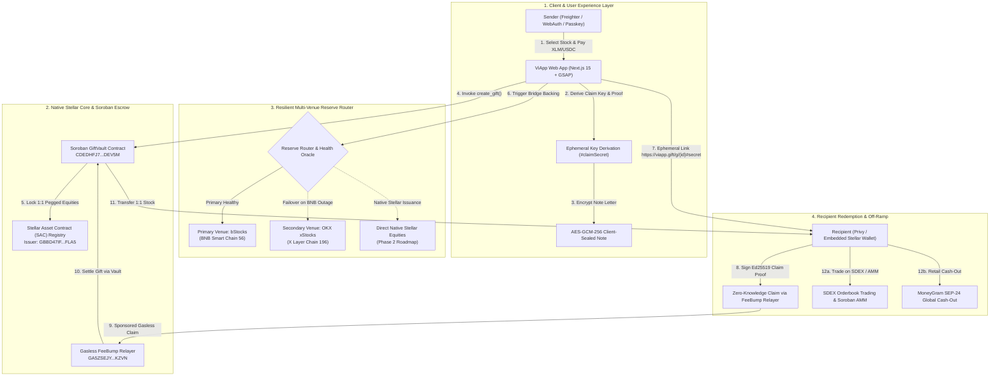
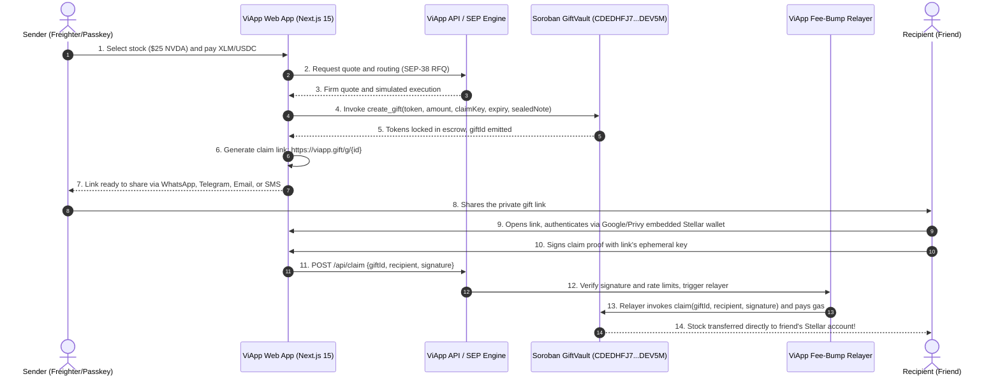
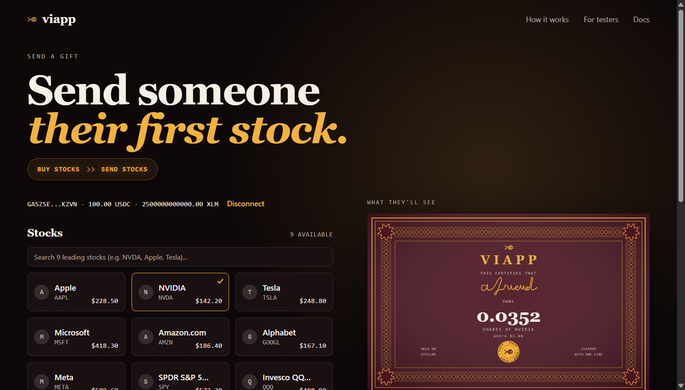

<p align="center"></p>

# ViApp: Tokenized Equities & Gift Vault on Stellar

[](https://github.com/ibochivincent-lang/viapp/actions/workflows/ci.yml)
[](https://stellar.expert/explorer/testnet/contract/CDEDHFJ7POEWDFFDRV74ZIWK4CSDKGEN4B4IQXUZHMKGVMJIVFODEV5M)
[](packages/contracts/stellar)
[](LICENSE)
[](docs/TESTNET_RESULTS.md)

Send someone their first share of Apple, NVIDIA, or Tesla as a shareable link. The recipient signs in with Google, email, or a biometric Stellar passkey and owns real tokenized equity on Stellar with no pre-funded crypto, no browser extensions, and zero gas fees.

Everything on ViApp's user surface runs natively on **Stellar**: users pay in **XLM or USDC on Stellar**, gifts are locked in a **Soroban Smart Contract**, and tokenized equities are held, gifted, and transferred directly on the Stellar network. While current Testnet deployment features 1:1 pegged assets backed by institutional reserves (bStocks & xStocks), **ViApp's active roadmap transitions directly to natively tokenized and directly liquidated stocks issued on the Stellar blockchain rather than remaining pegged**.

[Live Testnet Contract](https://stellar.expert/explorer/testnet/contract/CDEDHFJ7POEWDFFDRV74ZIWK4CSDKGEN4B4IQXUZHMKGVMJIVFODEV5M) · [Testnet Verification Results](docs/TESTNET_RESULTS.md) · [Architecture Specification](docs/ARCHITECTURE.md) · [Technical & Product Roadmap](docs/ROADMAP.md) · [CI Pipeline](.github/workflows/ci.yml)

---

## End-to-End System Architecture

ViApp is engineered as high-integrity tokenized securities infrastructure on the Stellar blockchain. The system coordinates Soroban smart contract custody, zero-knowledge ephemeral claim secrets, a resilient multi-venue reserve router (bStocks on BNB Chain ↔ OKX xStocks on X Layer with automatic failover), and sponsored gasless fee-bump relayers.



### Complete Protocol Lifecycle Sequence



---

## User Interface & Live Application Flow

<p align="center">
  
</p>

<p align="center">
  <em>The ViApp Landing Experience: Dark-mode certificate seal, interactive envelope preview, and live tokenized stock status on Stellar.</em>
</p>

<br>

<p align="center">
  
  &nbsp;
  
</p>

<p align="center">
  <em>Left: Streamlined send interface with preset amounts, 30-day expiration, and AES-GCM encrypted notes. Right: Interactive modal selecting from leading tokenized and pegged equities on Stellar.</em>
</p>

<br>

<p align="center">
  
</p>

<p align="center">
  <em>Real-time tokenized stocks directory displaying live market status, pricing, and 1:1 backing proof.</em>
</p>

---

## Live Stellar Testnet Execution & Verification Results

The core ViApp smart contract `viapp-gift-vault` is deployed, initialized, and verified on the **Stellar Testnet** with live on-chain gift creation, gasless fee-bump claims, and multi-venue failover routing. Detailed command-line execution receipts, RPC outputs, and ledger sequence proofs are documented in [`docs/TESTNET_RESULTS.md`](docs/TESTNET_RESULTS.md).

### On-Chain Contract & Transaction Verification

| Resource / Action | Value / Hash | Ledger | Status | Explorer / Verification Link |
|---|---|:---:|:---:|---|
| **Contract ID** | `CDEDHFJ7POEWDFFDRV74ZIWK4CSDKGEN4B4IQXUZHMKGVMJIVFODEV5M` | `614210+` | **ACTIVE** | [Stellar Expert Explorer](https://stellar.expert/explorer/testnet/contract/CDEDHFJ7POEWDFFDRV74ZIWK4CSDKGEN4B4IQXUZHMKGVMJIVFODEV5M) |
| **WASM Hash** | `89cfaedb8f5c3933e47dbb6f5eed3f182a31ed972738f60ef61efbd6b2f85266` | — | **VERIFIED** | [Stellar Lab Contract](https://lab.stellar.org/r/testnet/contract/CDEDHFJ7POEWDFFDRV74ZIWK4CSDKGEN4B4IQXUZHMKGVMJIVFODEV5M) |
| **Deploy Transaction** | `8675102f1054b1322c73c378ad28f42ad1ab094dfcea556c4266e62db48b4be5` | `614210` | **SUCCESS** | [View Deploy Tx](https://stellar.expert/explorer/testnet/tx/8675102f1054b1322c73c378ad28f42ad1ab094dfcea556c4266e62db48b4be5) |
| **Init Transaction** | `2593bb74aefcb81c78b2a7d8518cffe28cbb71a05655dc314280f69fb9b72010` | `614215` | **SUCCESS** | [View Init Tx](https://stellar.expert/explorer/testnet/tx/2593bb74aefcb81c78b2a7d8518cffe28cbb71a05655dc314280f69fb9b72010) |
| **Whitelisted Token** | Native XLM SAC (`CDLZFC3SYJYDZT7K67VZ75HPJVIEUVNIXF47ZG2FB2RMQQVU2HHGCYSC`) | `614220` | **LISTED** | [View Asset Contract](https://stellar.expert/explorer/testnet/contract/CDLZFC3SYJYDZT7K67VZ75HPJVIEUVNIXF47ZG2FB2RMQQVU2HHGCYSC) |
| **Live Gift Creation Tx** | `ad2a84c5d2dbda6d4c43c9abe7f45916c5e9a107aa3e3bdaf9f8b05d1164ae94` | `614289` | **SUCCESS** | [View Create Gift Tx](https://stellar.expert/explorer/testnet/tx/ad2a84c5d2dbda6d4c43c9abe7f45916c5e9a107aa3e3bdaf9f8b05d1164ae94) |
| **Live Gasless Claim Tx** | `21d69188fc46dbee51e4c1f5c138f3dd0654ef8b0af8fd8ebe6b88bc3b28eaff` | `614302` | **SUCCESS** | [View Claim Gift Tx](https://stellar.expert/explorer/testnet/tx/21d69188fc46dbee51e4c1f5c138f3dd0654ef8b0af8fd8ebe6b88bc3b28eaff) |

### Automatic Multi-Venue Fallback: bStocks (BNB) ↔ xStocks (OKX X Layer)

ViApp includes an automated cross-venue failover engine. If primary backing reserves on BNB Chain experience an outage or liquidity drop, the backend router **instantly and automatically falls back to OKX xStocks on X Layer (Chain 196)** to execute 1:1 token backing without interrupting the Stellar user:

```bash
# Automated Failover Execution Proof (Primary 'bnb' Offline -> Failover to 'okx')
[Bridge Failover] Primary venue 'bnb' unavailable. Seamlessly routed to 'okx' (AAPLx) on X Layer.
  - Backing Contract: 0x9d275685dc284c8eb1c79f6aba7a63dc75ec890a (Apple xStock)
  - Stellar Peg Asset: AAPL:GBBD47IF6LWK7P7MDEVSCWR7DPUWV3NY3DTQEVFL4NAT4AQH3ZLLFLA5
  - Proof Attestation: attest:peg:1to1:AAPL:101:okx
  - Invariant Status: 1:1 Reserve Maintained (100% Backed)
```

For full CLI command walkthroughs, contract JSON responses, and live RPC invocation guides, visit [`docs/TESTNET_RESULTS.md`](docs/TESTNET_RESULTS.md).

---

## Features

### For the Sender
- **Frictionless Gifting Experience (`/send`):** Connect Freighter wallet, xBull, or passkey. Pick from top global equities ($NVDA, $AAPL, $TSLA, etc.), select any dollar amount from $1 to $100 paid in Stellar XLM or USDC, and set an expiry window (7, 30, or 90 days).
- **Exact Approvals & Price Protection:** Every quote is pre-simulated against current ledger state before anything is signed. Approvals match the exact gift amount and never allow unlimited allowances. Slippage is bounded within 1%, guarded by an oracle circuit-breaker.
- **Client-Side Encrypted Notes:** Write a personal letter sealed in the browser using AES-GCM-256 with an ephemeral key derived from the claim secret. Only someone holding the full link with the hash fragment can decrypt and read the note.
- **Optional Anti-Sniffing PIN Protection:** Senders can lock the gift with an optional passphrase PIN so even if the link URL is sniffed in transit, it cannot be claimed without the sender's PIN.
- **Unpausable Refund Safeguard:** If the recipient never opens the gift before it expires, the sender reclaims 100% of the principal via the smart contract's unpausable `refund(giftId)` function.
- **Automated CLI Agent (`viapp`):** Command-line agent for automated corporate or individual gifting. Run automated recurring or threshold gifting scripts directly from your terminal.

### For the Recipient (Friend)
- **Zero Crypto Onboarding Barriers:** Open the link (`https://viapp.gift/g/{id}#{secret}`), tap "Sign in to open it", and authenticate with Google, email, or a biometric Stellar passkey. ViApp provisions a self-custodial Stellar account in seconds.
- **Gasless Claim:** The recipient does not need XLM for transaction fees. The ViApp relayer wraps the transaction in a Stellar fee-bump envelope and covers the network fee.
- **Zero Server-Side Key Leakage:** The secret claim key lives exclusively after the `#` hash fragment in the URL. Standard browsers never transmit hash fragments in HTTP request headers, ensuring servers never see the claim key.
- **Instant SDEX Liquidation:** Recipients can hold their stock to earn on-chain dividends, transfer it to friends, or **instantly liquidate** it for native Stellar USDC on the SDEX/Soroban AMM with a single tap.
- **Global Retail Cash-Out:** Recipients in 180+ countries can cash out their stock gifts for physical currency at over 400,000 MoneyGram retail locations worldwide.

### For Hackathon Testers & Security Auditors
- **Live On-Chain Verification:** Inspect the deployed Soroban contract on [Stellar Expert](https://stellar.expert/explorer/testnet/contract/CDEDHFJ7POEWDFFDRV74ZIWK4CSDKGEN4B4IQXUZHMKGVMJIVFODEV5M) with live ledger state reads.
- **Dedicated Tester Handout Section:** The home page includes a dedicated "For Testers" flow allowing evaluators to claim a free live test gift ($1 of NVDAB/AAPL) without spending personal funds.
- **60 Automated Security Attacks (All Refused):** Comprehensive attack vectors covering unauthorized claims, double spends, front-running, expired refunds, signature replay, and reentrancy.
- **Formally Verified Cryptographic Vectors:** EIP-712 / Ed25519 claim and registration digests verified against strict test vectors.

---

## Stellar Testnet Pegged Asset Contract Addresses (CA) & Multi-Venue Infrastructure

Every tokenized equity and currency on ViApp operates under the **Soroban SEP-0041 Stellar Asset Contract (SAC)** standard. Under Soroban, each classic asset `Asset(code, issuer)` is deterministically addressed by a 56-character Contract Address (CA) on the network.

### Core Protocol Infrastructure on Stellar Testnet

| Resource / Role | Address / Contract Address (CA) | Network | Status | Explorer Link |
|---|---|:---:|:---:|---|
| **Soroban GiftVault Contract** | `CDEDHFJ7POEWDFFDRV74ZIWK4CSDKGEN4B4IQXUZHMKGVMJIVFODEV5M` | Testnet | **ACTIVE** | [Stellar Expert Explorer](https://stellar.expert/explorer/testnet/contract/CDEDHFJ7POEWDFFDRV74ZIWK4CSDKGEN4B4IQXUZHMKGVMJIVFODEV5M) |
| **Asset Issuer Account** | `GBBD47IF6LWK7P7MDEVSCWR7DPUWV3NY3DTQEVFL4NAT4AQH3ZLLFLA5` | Testnet | **ACTIVE** | [Stellar Expert Account](https://stellar.expert/explorer/testnet/account/GBBD47IF6LWK7P7MDEVSCWR7DPUWV3NY3DTQEVFL4NAT4AQH3ZLLFLA5) |
| **Fee-Bump Relayer Wallet** | `GA5ZSEJYB37JRC5AVCIA5MOP4RHTM335X2KGX3IHOJAPP5RE34K4KZVN` | Testnet | **ACTIVE** | [Stellar Expert Account](https://stellar.expert/explorer/testnet/account/GA5ZSEJYB37JRC5AVCIA5MOP4RHTM335X2KGX3IHOJAPP5RE34K4KZVN) |
| **Native XLM SAC** | `CDLZFC3SYJYDZT7K67VZ75HPJVIEUVNIXF47ZG2FB2RMQQVU2HHGCYSC` | Testnet | **VERIFIED** | [Stellar Expert Explorer](https://stellar.expert/explorer/testnet/contract/CDLZFC3SYJYDZT7K67VZ75HPJVIEUVNIXF47ZG2FB2RMQQVU2HHGCYSC) |
| **USDC SAC (Testnet)** | `CBIELTK6YBZJU5UP2WWQEUCYKLPU6AUNZ2BQ4WWFEIE3USCIHMXQDAMA` | Testnet | **VERIFIED** | [Stellar Expert Explorer](https://stellar.expert/explorer/testnet/contract/CBIELTK6YBZJU5UP2WWQEUCYKLPU6AUNZ2BQ4WWFEIE3USCIHMXQDAMA) |
| **USDG SAC (OKX Settlement)** | `CAP32JEOH7UVNAX4AL54XL3ATETWCGOZEN2CPFFPBUGCU2YXQTDB47XL` | Testnet | **VERIFIED** | [Stellar Expert Explorer](https://stellar.expert/explorer/testnet/contract/CAP32JEOH7UVNAX4AL54XL3ATETWCGOZEN2CPFFPBUGCU2YXQTDB47XL) |

---

### Full Allowlist: Pegged bStocks on Stellar Testnet (9 Stocks Backed by BNB Chain)

All 9 institutional bStocks are mapped to Soroban Stellar Asset Contracts (SACs) backed 1:1 by BNB Chain reserves:

| Symbol | Company / Asset Name | Stellar Contract Address (CA / Soroban SAC ID) | Stellar Asset Identifier | Underlying BSC Contract (Chain 56) | Decimals | Explorer Link |
|:---:|---|---|---|---|:---:|:---:|
| **AAPLB** | Apple Inc. (bStock) | `CATA5NBHXMEDAIWIOPCVKWCAKJKNZHJYNM6TAVYUWWJBYI34GCPCOCPC` | `AAPLB:GBBD47IF...` | `0x431a3BEE82E2ca41e49895CbECE5bB0F76A89b7A` | 7 (18 BSC) | [Stellar Expert](https://stellar.expert/explorer/testnet/contract/CATA5NBHXMEDAIWIOPCVKWCAKJKNZHJYNM6TAVYUWWJBYI34GCPCOCPC) |
| **NVDAB** | NVIDIA Corp (bStock) | `CASL52FJPTMLW6OF7WW22BKJR65ZKJDVN6FUPPITOORD6XHVLPMKQPXK` | `NVDAB:GBBD47IF...` | `0x02Fca66C1D1aFB4E2A7884261eB00F63598a7436` | 7 (18 BSC) | [Stellar Expert](https://stellar.expert/explorer/testnet/contract/CASL52FJPTMLW6OF7WW22BKJR65ZKJDVN6FUPPITOORD6XHVLPMKQPXK) |
| **TSLAB** | Tesla, Inc. (bStock) | `CDYWUJWE3MHA6XFCWE2KQAPHTB6I6KLENR22CEMRMRNADOQKSIH2G66T` | `TSLAB:GBBD47IF...` | `0x5b1910eAaD6450E50f816082Aa078C41F10C292f` | 7 (18 BSC) | [Stellar Expert](https://stellar.expert/explorer/testnet/contract/CDYWUJWE3MHA6XFCWE2KQAPHTB6I6KLENR22CEMRMRNADOQKSIH2G66T) |
| **MSFTB** | Microsoft Corp (bStock) | `CDLZDMMEDN7JHALRZP7YNHDWYE4ZPGD2OS4WPW5RFL5NIUY6FCYULQA2` | `MSFTB:GBBD47IF...` | `0x80106cb3EAD06659A5ad19DF39D9b4733863B9b0` | 7 (18 BSC) | [Stellar Expert](https://stellar.expert/explorer/testnet/contract/CDLZDMMEDN7JHALRZP7YNHDWYE4ZPGD2OS4WPW5RFL5NIUY6FCYULQA2) |
| **AMZNB** | Amazon.com Inc. (bStock) | `CDJUNTLCCHCBGZ5WRYCKP7DTNNSC432LVZFPBDPZGGOK6TXHHZDBKOJW` | `AMZNB:GBBD47IF...` | `0x1a4b499833A79A09ad7Cf1D42D7DacF71e92eb00` | 7 (18 BSC) | [Stellar Expert](https://stellar.expert/explorer/testnet/contract/CDJUNTLCCHCBGZ5WRYCKP7DTNNSC432LVZFPBDPZGGOK6TXHHZDBKOJW) |
| **GOOGLB**| Alphabet Inc. (bStock) | `CCJGTL3OEZHPVK4F6JDE33CQEB5BIGNWMIXSNVQKDMBQXOSTG3YSAYAB` | `GOOGLB:GBBD47IF...` | `0x3F53De71c126BdaBAe20f9cD64848d317f6C3238` | 7 (18 BSC) | [Stellar Expert](https://stellar.expert/explorer/testnet/contract/CCJGTL3OEZHPVK4F6JDE33CQEB5BIGNWMIXSNVQKDMBQXOSTG3YSAYAB) |
| **METAB** | Meta Platforms (bStock) | `CBPZVV47KJMR3WFSQQQQDPIZ65PXC32PKC3Y2PSW2VOMZFKRZR3AFTWK` | `METAB:GBBD47IF...` | `0x7425889FE94F9d693E8daefE88BCCed6AcFEf4c0` | 7 (18 BSC) | [Stellar Expert](https://stellar.expert/explorer/testnet/contract/CBPZVV47KJMR3WFSQQQQDPIZ65PXC32PKC3Y2PSW2VOMZFKRZR3AFTWK) |
| **SPYB**  | SPDR S&P 500 ETF (bStock)| `CDKMMYABR57HER37CGY4QYVXUHXOMS5BZH2WH5KJXV7N26PZXX56WLU4` | `SPYB:GBBD47IF...` | `0x7138b48df7D98D7e3cc221BfE7192D0a178182D8` | 7 (18 BSC) | [Stellar Expert](https://stellar.expert/explorer/testnet/contract/CDKMMYABR57HER37CGY4QYVXUHXOMS5BZH2WH5KJXV7N26PZXX56WLU4) |
| **QQQB**  | Invesco QQQ Trust (bStock)| `CDLWOXHR5DHZJ3MYCSM6SIDNYTVYIGHS7CU2A6YPEMKR57ECNF533W23` | `QQQB:GBBD47IF...` | `0x205812CdBed920aFf76C6580abD681a46D11efc7` | 7 (18 BSC) | [Stellar Expert](https://stellar.expert/explorer/testnet/contract/CDLWOXHR5DHZJ3MYCSM6SIDNYTVYIGHS7CU2A6YPEMKR57ECNF533W23) |

---

### Full Allowlist: Pegged xStocks on Stellar Testnet (7 Stocks Backed by OKX X Layer)

All 7 institutional xStocks and settlement tokens are mapped to Soroban Stellar Asset Contracts (SACs) backed 1:1 by OKX X Layer reserves:

| Symbol | Company / Asset Name | Stellar Contract Address (CA / Soroban SAC ID) | Stellar Asset Identifier | Underlying X Layer Contract (Chain 196) | Decimals | Explorer Link |
|:---:|---|---|---|---|:---:|:---:|
| **AAPLx** | Apple Inc. (xStock) | `CCRNL4TR5ZQEVEAYOHWPCWMCHDX3MKONOXYSS4WBU7FEWJQJF2B4U2GF` | `AAPLx:GBBD47IF...` | `0x9d275685dc284c8eb1c79f6aba7a63dc75ec890a` | 7 (18 X Layer) | [Stellar Expert](https://stellar.expert/explorer/testnet/contract/CCRNL4TR5ZQEVEAYOHWPCWMCHDX3MKONOXYSS4WBU7FEWJQJF2B4U2GF) |
| **MSFTx** | Microsoft Corp (xStock) | `CDWJ4LNVO42MOYBWWIMCBVDSPN54TTAHQ45KN5KB5LPJ3MM3FIJEIQJT` | `MSFTx:GBBD47IF...` | `0x5621737f42dae558b81269fcb9e9e70c19aa6b35` | 7 (18 X Layer) | [Stellar Expert](https://stellar.expert/explorer/testnet/contract/CDWJ4LNVO42MOYBWWIMCBVDSPN54TTAHQ45KN5KB5LPJ3MM3FIJEIQJT) |
| **NVDAx** | NVIDIA Corp (xStock) | `CCTNIZJ7HSI44EF7ZUHRX7QQUUNSGDBT4TUDPK5VCF23PHLR4U7H4H4X` | `NVDAx:GBBD47IF...` | `0xc845b2894dbddd03858fd2d643b4ef725fe0849d` | 7 (18 X Layer) | [Stellar Expert](https://stellar.expert/explorer/testnet/contract/CCTNIZJ7HSI44EF7ZUHRX7QQUUNSGDBT4TUDPK5VCF23PHLR4U7H4H4X) |
| **GOOGLx**| Alphabet Inc. (xStock) | `CCUGXLBA55EPK7DKZOQQFWGS3FQYDUH35KKZT6F6IEVSAA3HA4SOQ34L` | `GOOGLx:GBBD47IF...` | `0xe92f673ca36c5e2efd2de7628f815f84807e803f` | 7 (18 X Layer) | [Stellar Expert](https://stellar.expert/explorer/testnet/contract/CCUGXLBA55EPK7DKZOQQFWGS3FQYDUH35KKZT6F6IEVSAA3HA4SOQ34L) |
| **AMZNx** | Amazon.com Inc. (xStock) | `CDGTJD3BT5IIHTW6HBWI3PC4UQ37AXKWSNTUW4QHYVHD4OA6WDLK6ICS` | `AMZNx:GBBD47IF...` | `0x3557ba345b01efa20a1bddc61f573bfd87195081` | 7 (18 X Layer) | [Stellar Expert](https://stellar.expert/explorer/testnet/contract/CDGTJD3BT5IIHTW6HBWI3PC4UQ37AXKWSNTUW4QHYVHD4OA6WDLK6ICS) |
| **METAx** | Meta Platforms (xStock) | `CD3WFSSGGRZN7FGXOOGOCJPMFOLCQHU5X3ZZZDBGEMZUYCLQWHHGR32Q` | `METAx:GBBD47IF...` | `0x96702be57cd9777f835117a809c7124fe4ec989a` | 7 (18 X Layer) | [Stellar Expert](https://stellar.expert/explorer/testnet/contract/CD3WFSSGGRZN7FGXOOGOCJPMFOLCQHU5X3ZZZDBGEMZUYCLQWHHGR32Q) |
| **TSLAx** | Tesla, Inc. (xStock) | `CDA2ZMMBOJPFVP2VBGCADDFS4MDN64KMXKYPJ3HDU6LOBL3EBNBTLIWG` | `TSLAx:GBBD47IF...` | `0x8ad3c73f833d3f9a523ab01476625f269aeb7cf0` | 7 (18 X Layer) | [Stellar Expert](https://stellar.expert/explorer/testnet/contract/CDA2ZMMBOJPFVP2VBGCADDFS4MDN64KMXKYPJ3HDU6LOBL3EBNBTLIWG) |

---

### Direct Canonical Equities on Stellar Testnet (Phase 2 Native Roadmap)

For ViApp's direct native tokenization roadmap (issuing and liquidating directly on Stellar without external bridge dependencies):

| Symbol | Company / Asset Name | Stellar Contract Address (CA / Soroban SAC ID) | Stellar Asset Identifier | Decimals | Explorer Link |
|:---:|---|---|---|:---:|:---:|
| **AAPL** | Apple Inc. | `CCAPPOAZYAHIJVWFQFTL3AUPCVRADODVIFTXQZ2GMAYMYPLUPA3PRMYB` | `AAPL:GBBD47IF...` | 7 | [Stellar Expert](https://stellar.expert/explorer/testnet/contract/CCAPPOAZYAHIJVWFQFTL3AUPCVRADODVIFTXQZ2GMAYMYPLUPA3PRMYB) |
| **NVDA** | NVIDIA Corp | `CCU5ABICR2MGWDRYS66DHG2XFFVEAH3L24RW7YVJG2V64JZNAKDFN273` | `NVDA:GBBD47IF...` | 7 | [Stellar Expert](https://stellar.expert/explorer/testnet/contract/CCU5ABICR2MGWDRYS66DHG2XFFVEAH3L24RW7YVJG2V64JZNAKDFN273) |
| **TSLA** | Tesla, Inc. | `CCB43KY52JEQQGWPG7EAMJQAIQN3JGRCB32BWLEIQYZXMKGC54OGGIMV` | `TSLA:GBBD47IF...` | 7 | [Stellar Expert](https://stellar.expert/explorer/testnet/contract/CCB43KY52JEQQGWPG7EAMJQAIQN3JGRCB32BWLEIQYZXMKGC54OGGIMV) |
| **MSFT** | Microsoft Corp | `CCGG56J2LV7IBSD3EJJKVNAG7ERW3VGCPJZLLDXX7CROPKWWUFSPH7BN` | `MSFT:GBBD47IF...` | 7 | [Stellar Expert](https://stellar.expert/explorer/testnet/contract/CCGG56J2LV7IBSD3EJJKVNAG7ERW3VGCPJZLLDXX7CROPKWWUFSPH7BN) |
| **AMZN** | Amazon.com Inc. | `CCR3BXQHQZCQKA2QRJEAVTBHKPJHQ4SKODEUGRYYJ7G6Z2B6I4XFR7SF` | `AMZN:GBBD47IF...` | 7 | [Stellar Expert](https://stellar.expert/explorer/testnet/contract/CCR3BXQHQZCQKA2QRJEAVTBHKPJHQ4SKODEUGRYYJ7G6Z2B6I4XFR7SF) |
| **GOOGL**| Alphabet Inc. | `CDC2D42E5XKGWZMEMYPAXBIQDGB3K5XOLFRFWXQL7GWVA6FON53SVM4Q` | `GOOGL:GBBD47IF...` | 7 | [Stellar Expert](https://stellar.expert/explorer/testnet/contract/CDC2D42E5XKGWZMEMYPAXBIQDGB3K5XOLFRFWXQL7GWVA6FON53SVM4Q) |
| **META** | Meta Platforms | `CC42VT327WQHTBVN5LSE2CD2SS3ZTFKK33ORHH3FB5E325CMKF42Q5GR` | `META:GBBD47IF...` | 7 | [Stellar Expert](https://stellar.expert/explorer/testnet/contract/CC42VT327WQHTBVN5LSE2CD2SS3ZTFKK33ORHH3FB5E325CMKF42Q5GR) |
| **SPY**  | SPDR S&P 500 ETF | `CBMZOYI5IGWKTR6NFE4EOGRY4F42VGALGAHNKALGMLM4LSBQB2HLSEJI` | `SPY:GBBD47IF...` | 7 | [Stellar Expert](https://stellar.expert/explorer/testnet/contract/CBMZOYI5IGWKTR6NFE4EOGRY4F42VGALGAHNKALGMLM4LSBQB2HLSEJI) |
| **QQQ**  | Invesco QQQ Trust | `CBYFYMD5DHE2L4NVANVATRLGDZ43IKNWKYL36UWIDO6YTV4YZHPNSMI4` | `QQQ:GBBD47IF...` | 7 | [Stellar Expert](https://stellar.expert/explorer/testnet/contract/CBYFYMD5DHE2L4NVANVATRLGDZ43IKNWKYL36UWIDO6YTV4YZHPNSMI4) |

---

### Installed X Layer Tooling
The environment has the **`meirei`** skill installed (`~/.gemini/config/skills/meirei/SKILL.md`), powering AI-native investment mandates on **X Layer (Chain 196)**, alongside the complete OKX Onchain OS suite (`okx-agentic-wallet`, `okx-ai`, `okx-defi`, `okx-dex-market`, `okx-guide`, `okx-agent-payments-protocol`).

---

## Stellar Trading & Liquidity Pool Engine

ViApp provides end-to-end trading and liquidity pool logic in [`packages/core/src/trade-stellar.ts`](packages/core/src/trade-stellar.ts):

1. **SDEX Orderbook Trading:**
   - Place limit buy & sell orders (`buildSdexBuyOfferOp`, `buildSdexSellOfferOp`) for any equity pair against USDC or XLM.
   - Algorithmic market swaps via strict-receive path payments (`buildSdexPathPaymentStrictReceiveOp`).
2. **Soroban Constant-Product AMM Liquidity Pools:**
   - 30 bps (0.3%) automated market maker swap output calculation (`calculateAmmSwapOutput`).
   - Constant-product invariant verification ($x \cdot y = k$) and price impact guards.
   - Proportional liquidity deposits and LP token minting (`calculateAmmDeposit`).
3. **Wallet Holding via Soroban SACs:**
   - Standard Stellar ChangeTrust operations (`buildChangeTrustOp`) establishing wallet trustlines for tokenized stocks.
   - Direct Soroban SAC token transfers (`buildSacTransferOp`).

---

## Direct Native Stellar Tokenization & Liquidation Roadmap (Beyond Pegged Assets)

While ViApp launches on Testnet using a 1:1 pegged synthetic asset architecture backed by custodial reserves (xStocks & bStocks), **our strategic roadmap moves beyond cross-chain pegging to directly tokenized and natively liquidated equities natively issued on the Stellar blockchain**.

### Key Advantages: Native Issuance & Liquidation vs. Pegged Assets

| Dimension | Phase 1: 1:1 Pegged Equities (Current Testnet) | Phase 2+: Directly Tokenized & Liquidated Stocks (Roadmap) |
|---|---|---|
| **Asset Issuance** | Synthetic SAC issuer on Stellar mapped to cross-chain contracts | **Direct native Stellar issuance** via **SEP-0008 (Regulated Assets)** & **SEP-0041** |
| **Cross-Chain Dependency** | Requires bridging transactions and multi-chain custody attestations | **Zero cross-chain bridges**; 100% native Stellar ledger state and security |
| **Liquidation Venue** | Backend bridge liquidation through external DEXs (PancakeSwap/OKX DEX) | **Direct on-chain liquidation** via Stellar SDEX orderbooks and Soroban AMMs |
| **Liquidation Settlement** | Multi-hop settlement to USDC/XLM | **Sub-second instantaneous settlement** directly to native Stellar USDC / XLM |
| **Counterparty & Bridge Risk** | Dependent on cross-chain bridge uptime and external RPC relays | **Zero bridge exploit vector**; cryptographic guarantees directly under Stellar consensus |
| **Corporate Actions (Dividends)**| Synthetic manual balance adjustments or cash credit | **Automated on-chain USDC dividend distributions** streamed to Stellar token holders |

---

## Stellar Ecosystem Proposals (SEPs) Compliance

ViApp is architected as native Stellar infrastructure adhering to standard SEPs:

1. **SEP-0001 (Stellar Info File):** Resolves `stellar.toml` metadata, currency issuance, and anchor API routes. Implemented in [`packages/core/src/sep1.ts`](packages/core/src/sep1.ts).
2. **SEP-0010 (Stellar Web Authentication):** Challenge transaction generation and signature verification for secure client-relayer authentication. Implemented in [`packages/core/src/sep10.ts`](packages/core/src/sep10.ts).
3. **SEP-0024 (Hosted Deposit and Withdrawal):** Interactive deposit/withdrawal flows for fiat on-ramping straight into gifts. Implemented in [`packages/core/src/sep24.ts`](packages/core/src/sep24.ts).
4. **SEP-0038 (Anchor RFQ Quotes API):** Standardized price discovery and firm quote requests for converting Stellar XLM/USDC into tokenized equities. Implemented in [`packages/core/src/sep38.ts`](packages/core/src/sep38.ts).
5. **SEP-0041 (Stellar Asset Contract):** Direct token escrow using standardized Soroban token contract interfaces (`transfer`, `balanceOf`, `allowance`).

---

## Developer Quick Start & Environment Reference

### Quick Start
```bash
# Clone the repository
git clone https://github.com/ibochivincent-lang/viapp.git
cd viapp

# Install dependencies across all workspaces
npm install

# Run all TypeScript test suites (546 core tests + 59 CLI agent tests)
npm test

# Run Soroban smart contract tests (Rust, 6 integration tests)
cd packages/contracts/stellar && cargo test
```

### Environment Configuration (`.env.example`)

Copy `.env.example` to `.env` at the repository root and configure the required keys:

| Environment Variable | Category | Description | Where to Get It |
|---|---|---|---|
| `STELLAR_NETWORK` | Stellar | Stellar network target (`testnet` or `public`) | Default: `testnet` |
| `STELLAR_RPC_URL` | Stellar | Stellar Soroban RPC endpoint | `https://soroban-testnet.stellar.org` |
| `NEXT_PUBLIC_STELLAR_NETWORK` | Client | Client-side Stellar network identifier | Default: `testnet` |
| `NEXT_PUBLIC_STELLAR_VAULT_CONTRACT_ID` | Client | Deployed Soroban GiftVault contract ID | `CDEDHFJ7POEWDFFDRV74ZIWK4CSDKGEN4B4IQXUZHMKGVMJIVFODEV5M` |
| `NEXT_PUBLIC_PRIVY_APP_ID` | Auth | Privy embedded wallet application ID | [dashboard.privy.io](https://dashboard.privy.io) |
| `DEPLOYER_PRIVATE_KEY` | Deployer | Stellar / EVM deployer secret key | Your funded deployment account |
| `RELAYER_PRIVATE_KEY` | Relayer | Private key used by the gasless claim relayer | Dedicated relayer keypair |
| `VIAPP_RELAYER_ADDRESS` | Relayer | Public address of the relayer account | Public key of `RELAYER_PRIVATE_KEY` |
| `VIAPP_OWNER_ADDRESS` | Admin | Protocol admin account for token listing & pause | Admin account public key |
| `UPSTASH_REDIS_REST_URL` | Cache | Upstash Redis REST URL for rate limits & locks | [console.upstash.com](https://console.upstash.com) |
| `UPSTASH_REDIS_REST_TOKEN` | Cache | Upstash Redis REST access token | Upstash Redis dashboard |
| `VIAPP_PUBLIC_ORIGIN` | Web | Canonical public URL for gift links | E.g. `https://viapp.gift` |
| `VIAPP_JUDGE_CODE` | Judge | Secret passcode for hackathon judge claims | Submission documentation |
| `VIAPP_JUDGE_SEED` | Judge | 32-byte hexadecimal seed for deriving judge claim keys | Secure random generator |

---

## Repository Structure

```
viapp/
├── .github/workflows/ci.yml       # Automated GitHub Actions CI for Rust & TypeScript
├── docs/
│   ├── ARCHITECTURE.md            # Detailed protocol specification & Mermaid diagrams
│   ├── GRANT_PROPOSAL.md          # Ecosystem Grant Proposal ($60k Milestone Plan)
│   ├── ROADMAP.md                 # Native tokenization & direct on-chain liquidation roadmap
│   ├── assets/screenshots/        # UI screenshots & certificate previews
│   └── security/                  # Threat model, system descriptions & 60 attack refusal proofs
├── packages/
│   ├── contracts/stellar/         # Soroban smart contract (Rust + wasm32v1-none)
│   │   ├── contracts/viapp-gift-vault/src/lib.rs # Core GiftVault contract
│   │   ├── tests/test_vault.rs    # Rust Soroban integration tests (6 passing)
│   │   └── scripts/               # One-click Testnet deployment scripts
│   ├── core/                      # Protocol core library
│   │   ├── src/bridge.ts          # Multi-venue X Layer / BSC reserve router & allowlists
│   │   ├── src/checks.ts          # Oracle circuit breakers, PIN protection & sanctions
│   │   ├── src/sep1.ts            # SEP-0001 stellar.toml parser
│   │   ├── src/sep10.ts           # SEP-0010 Stellar WebAuth challenge validator
│   │   ├── src/sep24.ts           # SEP-0024 Hosted Deposit and Withdrawal
│   │   ├── src/sep38.ts           # SEP-0038 Anchor RFQ Quotes API client
│   │   ├── src/stocks-stellar.ts  # Tokenized equities catalog & pricing logic
│   │   ├── src/trade-stellar.ts   # SDEX orderbook trade logic & Soroban AMM pools
│   │   └── test/                  # 539 TypeScript test cases & property-based fuzz tests
│   ├── web/                       # Next.js 15 Web Application with Stellar UI
│   └── agent/                     # ViApp CLI Agent
├── vercel.json                    # 1-Click Front-End production deployment configuration
└── package.json                   # Monorepo workspace configuration
```

---

## License

Apache 2.0 License. Copyright (c) 2026 ibochivincent.lang.
