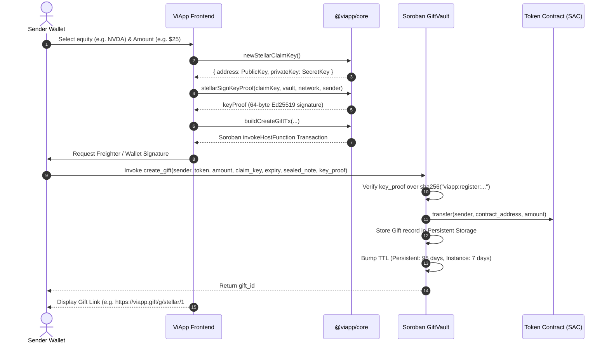
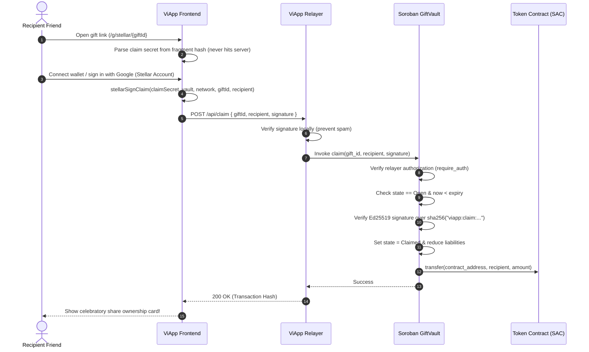

# ViApp Architecture & Protocol Specification

ViApp is a decentralized protocol on Stellar enabling users to purchase, tokenize, and gift shares of real-world equities (e.g. Apple, NVIDIA, Tesla) as shareable web links. The recipient can claim their gift without owning pre-funded crypto or paying transaction fees, while the sender retains full non-custodial ownership and refund guarantees.

---

## 1. High-Level System Architecture

```mermaid
flowchart TD
    subgraph Client["Client Interface"]
        Sender["Gift Sender\n(XLM / USDC on Stellar)"]
        Recipient["Gift Recipient\n(Web Browser / Google / Passkey)"]
    end

    subgraph AppLayer["Application Layer (@viapp/web)"]
        UI["ViApp Web App\n(Next.js 16 + Tailwind)"]
        Relayer["ViApp Gasless Relayer\n(Submits claim transactions)"]
    end

    subgraph CoreLayer["Core Protocol (@viapp/core)"]
        StellarClient["Soroban SDK Transaction Builders"]
        SEP["SEP Engine\n(SEP-1, SEP-10, SEP-38, SEP-41)"]
        Bridge["Pegging & Settlement Engine\n(1:1 Pegged Equities)"]
    end

    subgraph OnChain["Stellar Network (Soroban)"]
        Vault["GiftVault Smart Contract\nCDEDHFJ7POEWDFFDRV74ZIWK4CSDKGEN4B4IQXUZHMKGVMJIVFODEV5M"]
        SAC["Stellar Asset Contracts\n(Native XLM, USDC, Pegged Stocks)"]
        Ledger["Stellar Ledger\n(State Storage + TTL Extensions)"]
    end

    Sender -->|1. Select Stock & Pay XLM/USDC| UI
    UI --> CoreLayer
    CoreLayer -->|2. Create Gift & Lock Tokens| Vault
    Vault -->|3. Escrow Tokens| SAC
    Vault -->|4. Store Gift State with TTL Bump| Ledger

    UI -->|5. Generate Shareable Claim Link| Sender
    Sender -.->|6. Sends Link (SMS / WhatsApp / Email)| Recipient

    Recipient -->|7. Opens Link & Authenticates| UI
    UI -->|8. Signed Claim Payload| Relayer
    Relayer -->|9. Submits claim() on behalf of friend| Vault
    Vault -->|10. Transfers Pegged Stock to Recipient| SAC
```

---

## 2. Deployed Soroban Smart Contract

The core smart contract `viapp-gift-vault` is deployed, initialized, and verified on Stellar Testnet:

* **Contract ID:** [`CDEDHFJ7POEWDFFDRV74ZIWK4CSDKGEN4B4IQXUZHMKGVMJIVFODEV5M`](https://stellar.expert/explorer/testnet/contract/CDEDHFJ7POEWDFFDRV74ZIWK4CSDKGEN4B4IQXUZHMKGVMJIVFODEV5M)
* **WASM Hash:** `89cfaedb8f5c3933e47dbb6f5eed3f182a31ed972738f60ef61efbd6b2f85266`
* **Network:** Stellar Testnet (`Test SDF Network ; September 2015`)
* **Deploy Transaction:** [`8675102f...`](https://stellar.expert/explorer/testnet/tx/8675102f1054b1322c73c378ad28f42ad1ab094dfcea556c4266e62db48b4be5)
* **Initialization Transaction:** [`2593bb74...`](https://stellar.expert/explorer/testnet/tx/2593bb74aefcb81c78b2a7d8518cffe28cbb71a05655dc314280f69fb9b72010)
* **Initial Listed Token:** Native XLM SAC (`CDLZFC3SYJYDZT7K67VZ75HPJVIEUVNIXF47ZG2FB2RMQQVU2HHGCYSC`)

---

## 3. Core Protocol Workflows

### 3.1 Gift Creation Flow



### 3.2 Gasless Claim Settlement Flow



---

## 4. Soroban Storage & TTL Lifecycle

Soroban storage fees are tiered into `Instance` and `Persistent` storage. ViApp manages these deterministically to prevent state eviction:

| Storage Type | Key | Purpose | TTL Bump Policy |
|:---|:---|:---|:---|
| **Instance** | `Admin`, `Relayer`, `NextGiftId`, `IsPaused` | Global protocol parameters | Bumped by `7 days` whenever TTL drops below `1 day`. |
| **Persistent** | `Gift(gift_id)` | Individual gift record (token, sender, amount, expiry, state) | Bumped by `95 days` (exceeding maximum 90-day gift lifetime). |
| **Persistent** | `ClaimKeyUsed(claim_key)` | Nullifier preventing replay of claim keys | Persists indefinitely to guarantee one-time use. |
| **Persistent** | `Liabilities(token)` | Real-time accounting of tokens currently escrowed | Updated on every `create_gift`, `claim`, and `refund`. |

---

## 5. Stellar Standards Compliance (SEPs)

ViApp integrates standard Stellar Ecosystem Proposals to guarantee interoperability:

* **SEP-0001 (Stellar Info File):** Machine-readable discovery (`stellar.toml`) exporting protocol metadata, signers, currencies, and anchor endpoints. Implemented in [`packages/core/src/sep1.ts`](file:///C:/Users/User/.gemini/antigravity/scratch/viapp/packages/core/src/sep1.ts).
* **SEP-0010 (Stellar Web Authentication):** Standardized challenge transaction builder and validator for mutual authentication between client and relayer. Implemented in [`packages/core/src/sep10.ts`](file:///C:/Users/User/.gemini/antigravity/scratch/viapp/packages/core/src/sep10.ts).
* **SEP-0038 (Anchor RFQ Quotes API):** Standardized indicative pricing and firm quote requests for converting between on-chain assets (USDC, XLM) and tokenized equities. Implemented in [`packages/core/src/sep38.ts`](file:///C:/Users/User/.gemini/antigravity/scratch/viapp/packages/core/src/sep38.ts).
* **SEP-0041 (Stellar Asset Contract):** Direct token escrow using standardized SAC interfaces (`transfer`, `balanceOf`).

---

## 6. Threat Model & Security Invariants

1. **Checks-Effects-Interactions:** State transitions (`gift.state = Claimed` or `Refunded`) are committed before any token transfer is executed, preventing reentrancy.
2. **Replay Protection via Cryptographic Digest:** Every registration and claim signature includes the `network_id`, `contract_id`, `gift_id`, and `recipient` in the signed preimage. A signature captured on Testnet cannot be replayed on Mainnet or across distinct contracts.
3. **Sender Refund Guarantee:** The sender can invoke `refund(gift_id)` at any time after `expiry` has elapsed. The `refund()` function is strictly unpausable, guaranteeing that administrative actions can never trap user funds.
4. **Zero-Knowledge Gift Link:** The secret claim key is transmitted entirely within the URL fragment hash (`#...`), ensuring it is never transmitted over HTTP headers or stored in web server access logs.

