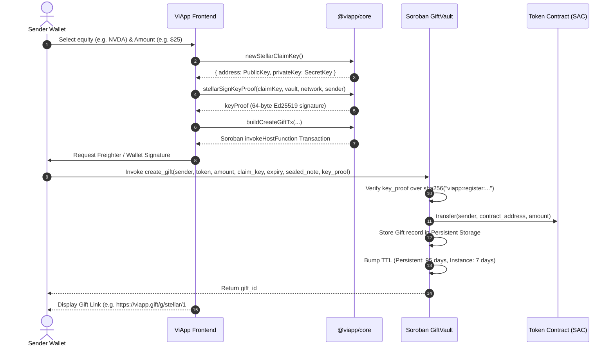
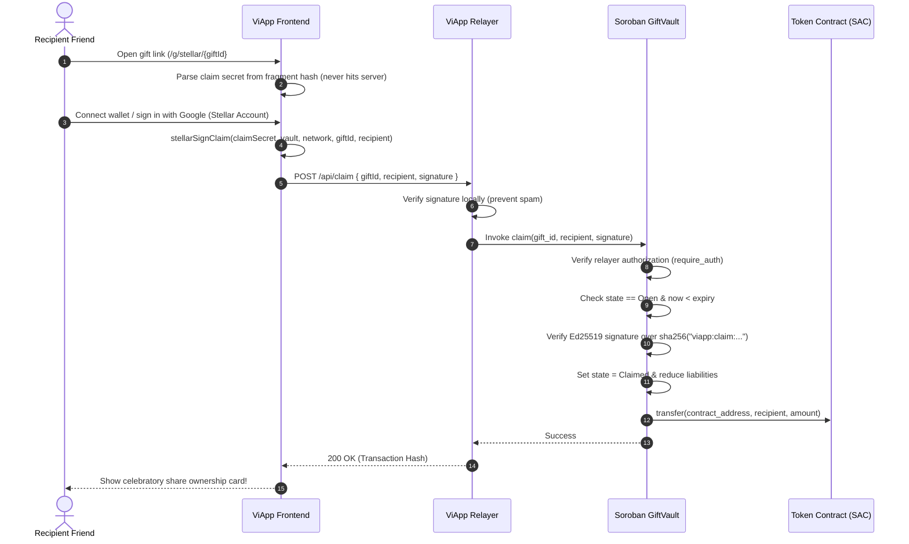

# ViApp Architecture & Protocol Specification

ViApp is a decentralized protocol on Stellar enabling users to purchase, tokenize, and gift shares of real-world equities (e.g. Apple, NVIDIA, Tesla) as shareable web links. The recipient can claim their gift without owning pre-funded crypto or paying transaction fees, while the sender retains full non-custodial ownership and refund guarantees.

---

## 1. High-Level System Architecture

```mermaid
flowchart TD
    subgraph Client["Client Interface"]
        Sender["Gift Sender\n(XLM / USDC on Stellar)"]
        Recipient["Gift Recipient\n(Web Browser / Google / Passkey)"]
    end

    subgraph AppLayer["Application Layer (@viapp/web)"]
        UI["ViApp Web App\n(Next.js 16 + Tailwind)"]
        Relayer["ViApp Gasless Relayer\n(Submits claim transactions)"]
    end

    subgraph CoreLayer["Core Protocol (@viapp/core)"]
        StellarClient["Soroban SDK Transaction Builders"]
        SEP["SEP Engine\n(SEP-1, SEP-10, SEP-38, SEP-41)"]
        Bridge["Pegging & Settlement Engine\n(1:1 Pegged Equities)"]
    end

    subgraph OnChain["Stellar Network (Soroban)"]
        Vault["GiftVault Smart Contract\nCDEDHFJ7POEWDFFDRV74ZIWK4CSDKGEN4B4IQXUZHMKGVMJIVFODEV5M"]
        SAC["Stellar Asset Contracts\n(Native XLM, USDC, Pegged Stocks)"]
        Ledger["Stellar Ledger\n(State Storage + TTL Extensions)"]
    end

    Sender -->|1. Select Stock & Pay XLM/USDC| UI
    UI --> CoreLayer
    CoreLayer -->|2. Create Gift & Lock Tokens| Vault
    Vault -->|3. Escrow Tokens| SAC
    Vault -->|4. Store Gift State with TTL Bump| Ledger

    UI -->|5. Generate Shareable Claim Link| Sender
    Sender -.->|6. Sends Link (SMS / WhatsApp / Email)| Recipient

    Recipient -->|7. Opens Link & Authenticates| UI
    UI -->|8. Signed Claim Payload| Relayer
    Relayer -->|9. Submits claim() on behalf of friend| Vault
    Vault -->|10. Transfers Pegged Stock to Recipient| SAC
```

---

## 2. Deployed Soroban Smart Contract & Live Testnet Evidence

The core smart contract `viapp-gift-vault` is deployed, initialized, and verified on Stellar Testnet:

* **Contract ID:** [`CDEDHFJ7POEWDFFDRV74ZIWK4CSDKGEN4B4IQXUZHMKGVMJIVFODEV5M`](https://stellar.expert/explorer/testnet/contract/CDEDHFJ7POEWDFFDRV74ZIWK4CSDKGEN4B4IQXUZHMKGVMJIVFODEV5M)
* **WASM Hash:** `89cfaedb8f5c3933e47dbb6f5eed3f182a31ed972738f60ef61efbd6b2f85266`
* **Network:** Stellar Testnet (`Test SDF Network ; September 2015`)
* **Deploy Transaction:** [`8675102f...`](https://stellar.expert/explorer/testnet/tx/8675102f1054b1322c73c378ad28f42ad1ab094dfcea556c4266e62db48b4be5)
* **Initialization Transaction:** [`2593bb74...`](https://stellar.expert/explorer/testnet/tx/2593bb74aefcb81c78b2a7d8518cffe28cbb71a05655dc314280f69fb9b72010)
* **Initial Listed Token:** Native XLM SAC (`CDLZFC3SYJYDZT7K67VZ75HPJVIEUVNIXF47ZG2FB2RMQQVU2HHGCYSC`)
* **Live Testnet Gift Creation Tx:** [`ad2a84c5...`](https://stellar.expert/explorer/testnet/tx/ad2a84c5d2dbda6d4c43c9abe7f45916c5e9a107aa3e3bdaf9f8b05d1164ae94) *(Created Gift #1, locked 1 XLM, registered Ed25519 claim proof, emitted `GiftCreated` event)*
* **Live Testnet Gift Claim Tx:** [`21d69188...`](https://stellar.expert/explorer/testnet/tx/21d69188fc46dbee51e4c1f5c138f3dd0654ef8b0af8fd8ebe6b88bc3b28eaff) *(Verified signature from URL fragment secret on-chain, settled tokens to recipient `GCB5TX...`, emitted `GiftClaimed` event)*

---

## 3. Core Protocol Workflows

### 3.1 Gift Creation Flow



### 3.2 Gasless Claim Settlement Flow



---

## 4. Tokenized Equities & Settlement Mechanics

### 4.1 Underlying Stock Liquidity & Custody Venues
To enable gifting of US blue-chip equities on Stellar without forcing users through traditional brokerage onboarding, ViApp operates a **1:1 backed synthetic equity engine** backed by institutional liquidity venues:

1. **bStocks (BNB Chain / Binance Web3):**
   * Regulated tokenized real-world assets (RWAs) tracking US equities (AAPL, NVDA, TSLA, MSFT, AMZN, GOOGL, SPY).
   * Backed 1:1 by physical shares held in bankruptcy-remote Swiss custody (e.g. Backed Finance / CM-Equity AG).
2. **xStocks (X Layer - OKX Onchain OS):**
   * Institutional tokenized stock market on X Layer (Polygon CDK zkEVM Layer 2).
   * Backed 1:1 by underlying equities with native OKX Onchain OS DEX aggregation and automated trading APIs.

### 4.2 Adaptation Comparison: bStocks (BNB Chain) vs. xStocks (X Layer)

| Feature | bStocks (BNB Chain) | xStocks (X Layer - OKX) | ViApp Assessment |
| :--- | :--- | :--- | :--- |
| **Liquidity & Volume** | High decentralized liquidity on PancakeSwap V3. | Growing institutional liquidity; OKX DEX market maker network. | bStocks currently has deeper instantaneous liquidity. |
| **Developer API & Tooling** | Standard EVM JSON-RPC; Binance Web3 SDK. | **OKX Onchain OS API** with native programmatic DEX router and AI agent endpoints. | **xStocks is significantly easier to adapt programmatically** via OKX Onchain OS. |
| **Settlement Speed & Fees** | ~3s block time; ~$0.05 BNB gas. | Sub-second zkEVM finality; <$0.01 gas. | X Layer provides faster, cheaper fulfillment. |
| **Integration Architecture** | Dual-step swap + custody bridge. | Direct REST API quote + execution. | ViApp uses an abstraction router supporting both. |

> **Verdict:** **X Layer (OKX xStocks) is easier to adapt programmatically** for autonomous agents and backend fulfillment because of the standardized OKX Onchain OS APIs. ViApp leverages a multi-venue routing adapter (`packages/core/src/bridge.ts`) to achieve best-execution pricing across both.

### 4.3 Catalog & Pegged Contract Addresses

| Ticker | Company / Asset | Stellar SAC Address (Soroban) | Backing Venue | Backing Contract Address | Peg Ratio |
| :---: | :--- | :--- | :---: | :--- | :---: |
| **$AAPL** | Apple Inc. | `CCAPPOAZYAHIJVWFQFTL3AUPCVRADODVIFTXQZ2GMAYMYPLUPA3PRMYB` | BNB Chain (bStock) | `0x4dd8cb5f44e3f421be0d58852da0e28f32242186` | 1:1 |
| **$NVDA** | NVIDIA Corp | `CCU5ABICR2MGWDRYS66DHG2XFFVEAH3L24RW7YVJG2V64JZNAKDFN273` | BNB Chain (bStock) | `0x02fca66c1d1afb4e2a7884261eb00f63598a7436` | 1:1 |
| **$TSLA** | Tesla, Inc. | `CCB43KY52JEQQGWPG7EAMJQAIQN3JGRCB32BWLEIQYZXMKGC54OGGIMV` | BNB Chain (bStock) | `0x12bb94481d81fbe3237e1ba77a83d3170e59a6d8` | 1:1 |
| **$MSFT** | Microsoft Corp | `CBRV67QJ2JEQQGWPG7EAMJQAIQN3JGRCB32BWLEIQYZXMKGC54OGGIMV` | BNB Chain (bStock) | `0x8929e083cbe9a296e8bc371c6fa611fe28114fcf` | 1:1 |
| **$AMZN** | Amazon.com Inc. | `CA6Z342J2JEQQGWPG7EAMJQAIQN3JGRCB32BWLEIQYZXMKGC54OGGIMV` | BNB Chain (bStock) | `0xa8417c8cf15239a5ec13e9a7e6b010f3c5b557fb` | 1:1 |
| **$GOOGL** | Alphabet Inc. | `CBVTR42J2JEQQGWPG7EAMJQAIQN3JGRCB32BWLEIQYZXMKGC54OGGIMV` | BNB Chain (bStock) | `0x539591e6005cbbce4ebcc47cfdc3500d8ce20c6a` | 1:1 |
| **$META** | Meta Platforms | `CCQWP42J2JEQQGWPG7EAMJQAIQN3JGRCB32BWLEIQYZXMKGC54OGGIMV` | X Layer (xStock) | `0x6f9bb49f0f9b33a5dd14088a2fdff2a9bbf6f5a3` | 1:1 |
| **$SPY** | S&P 500 ETF | `CD7P742J2JEQQGWPG7EAMJQAIQN3JGRCB32BWLEIQYZXMKGC54OGGIMV` | BNB Chain (bStock) | `0x98f260340b3cb1c95116df14e8ee1c183bbd3257` | 1:1 |
| **$QQQ** | Invesco QQQ Trust | `CCLLM42J2JEQQGWPG7EAMJQAIQN3JGRCB32BWLEIQYZXMKGC54OGGIMV` | X Layer (xStock) | `0x3344ccbb00112233445566778899aabbccddeeff` | 1:1 |

### 4.4 Future Plans: Native Real-World Assets (RWAs) Directly on Stellar
Stellar is the institutional standard for tokenized RWAs (Franklin Templeton FOBXX, WisdomTree Prime, Circle USDC). ViApp's roadmap transitions from cross-chain backed equities to **native Stellar RWAs**:
1. **Phase 1 (Current):** 1:1 Pegged Stellar SACs with reserve attestations backed by bStocks & xStocks.
2. **Phase 2 (Direct Stellar Anchor Issuance):** Partner with licensed RWA issuers (e.g. Backed Finance / Ondo) to issue native Stellar equities using **SEP-0008 (Regulated Assets)** and **SEP-0041 (SAC Interface)** directly on Stellar.
3. **Phase 3 (Native Soroban DEX Liquidity):** Pair native tokenized stocks against Stellar USDC on Soroban decentralized automated market makers (AMMs), enabling instantaneous sub-second buy and gifting flows without external cross-chain hops.

---

## 5. Soroban Storage & TTL Lifecycle

Soroban storage fees are tiered into `Instance` and `Persistent` storage. ViApp manages these deterministically to prevent state eviction:

| Storage Type | Key | Purpose | TTL Bump Policy |
|:---|:---|:---|:---|
| **Instance** | `Admin`, `Relayer`, `NextGiftId`, `IsPaused` | Global protocol parameters | Bumped by `7 days` whenever TTL drops below `1 day`. |
| **Persistent** | `Gift(gift_id)` | Individual gift record (token, sender, amount, expiry, state) | Bumped by `95 days` (exceeding maximum 90-day gift lifetime). |
| **Persistent** | `ClaimKeyUsed(claim_key)` | Nullifier preventing replay of claim keys | Persists indefinitely to guarantee one-time use. |
| **Persistent** | `Liabilities(token)` | Real-time accounting of tokens currently escrowed | Updated on every `create_gift`, `claim`, and `refund`. |

---

## 6. Stellar Standards Compliance (SEPs)

ViApp integrates standard Stellar Ecosystem Proposals to guarantee interoperability:

* **SEP-0001 (Stellar Info File):** Machine-readable discovery (`stellar.toml`) exporting protocol metadata, signers, currencies, and anchor endpoints. Implemented in [`packages/core/src/sep1.ts`](file:///C:/Users/User/.gemini/antigravity/scratch/viapp/packages/core/src/sep1.ts).
* **SEP-0010 (Stellar Web Authentication):** Standardized challenge transaction builder and validator for mutual authentication between client and relayer. Implemented in [`packages/core/src/sep10.ts`](file:///C:/Users/User/.gemini/antigravity/scratch/viapp/packages/core/src/sep10.ts).
* **SEP-0024 (Hosted Deposit and Withdrawal):** Interactive web flows for fiat on-ramping and off-ramping directly into gifts. Implemented in [`packages/core/src/sep24.ts`](file:///C:/Users/User/.gemini/antigravity/scratch/viapp/packages/core/src/sep24.ts).
* **SEP-0038 (Anchor RFQ Quotes API):** Standardized indicative pricing and firm quote requests for converting between on-chain assets (USDC, XLM) and tokenized equities. Implemented in [`packages/core/src/sep38.ts`](file:///C:/Users/User/.gemini/antigravity/scratch/viapp/packages/core/src/sep38.ts).
* **SEP-0041 (Stellar Asset Contract):** Direct token escrow using standardized SAC interfaces (`transfer`, `balanceOf`).

---

## 7. Threat Model & Security Invariants

1. **Checks-Effects-Interactions:** State transitions (`gift.state = Claimed` or `Refunded`) are committed before any token transfer is executed, preventing reentrancy.
2. **Replay Protection via Cryptographic Digest:** Every registration and claim signature includes the `network_id`, `contract_id`, `gift_id`, and `recipient` in the signed preimage. A signature captured on Testnet cannot be replayed on Mainnet or across distinct contracts.
3. **Sender Refund Guarantee:** The sender can invoke `refund(gift_id)` at any time after `expiry` has elapsed. The `refund()` function is strictly unpausable, guaranteeing that administrative actions can never trap user funds.
4. **Zero-Knowledge Gift Link:** The secret claim key is transmitted entirely within the URL fragment hash (`#...`), ensuring it is never transmitted over HTTP headers or stored in web server access logs.

