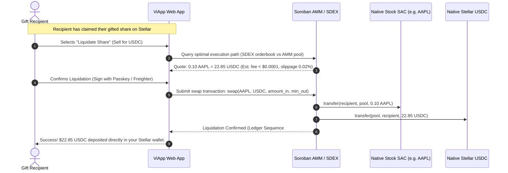

# ViApp Technical & Product Roadmap: Native Stellar Tokenization & Direct Liquidation

This document defines the strategic and technical roadmap for **ViApp**, detailing our evolution from an initial **1:1 cross-chain pegged equity model** to **natively tokenized and directly liquidated stocks on the Stellar blockchain**.

---

## Executive Summary: The Shift to Native Stellar Equities

ViApp began on Stellar Testnet with a proven 1:1 synthetic pegged model: users pay with Stellar USDC/XLM, and ViApp locks 1:1 pegged Stellar Asset Contracts (SACs) in the Soroban GiftVault, backed by institutional reserves on BNB Chain (bStocks).

While this proved that gifting equities on Stellar is frictionless and gasless, **our long-term architectural goal is to eliminate cross-chain pegs and bridges entirely**. ViApp is bringing **liquidated and tokenized stocks directly into the Stellar blockchain**:

1. **Direct Native Tokenization:** Shares of US blue-chip companies (Apple, NVIDIA, Tesla, S&P 500) will be minted and issued natively on the Stellar ledger as **SEP-0008 Regulated Assets** and wrapped with **SEP-0041 Soroban Smart Asset Contracts (SACs)**.
2. **Direct On-Chain Liquidation:** Rather than relying on external cross-chain DEXs or off-chain settlement to sell shares, tokenized stocks on Stellar will be **liquidated directly on the Stellar Decentralized Exchange (SDEX) and Soroban AMM liquidity pools**. Anyone holding a gifted stock can liquidate it back into native Stellar USDC or XLM with sub-second finality and sub-cent network fees.
3. **Zero Bridge Risk:** By tokenizing and liquidating directly on Stellar, ViApp removes bridge honeypots, wrapped-token de-pegging risks, and multi-chain gas dependencies.

---

## High-Level Architecture: Pegged Model vs. Native Direct Liquidation

```mermaid
flowchart TD
    subgraph Current["Phase 1: 1:1 Pegged Equities (Current Testnet)"]
        direction TB
        P_Sender["Sender (Stellar USDC/XLM)"] --> P_Vault["Soroban GiftVault\nCDEDHFJ7..."]
        P_Vault --> P_Peg["1:1 Pegged SAC (e.g. AAPL SAC)"]
        P_Bridge["ViApp Backend Bridge"] -.->|Cross-chain hop| P_Reserves["bStocks (BNB)\nCustodial Reserves"]
        P_Friend["Recipient Claim"] --> P_Peg
        P_Liq["Liquidation"] -.->|Multi-chain bridge| P_ExtDEX["External DEX (PancakeSwap)"]
    end

    subgraph Future["Phases 2-3: Direct Native Tokenization & On-Chain Liquidation (Target)"]
        direction TB
        N_Sender["Sender (Stellar USDC/XLM)"] --> N_Vault["Soroban GiftVault"]
        N_Anchor["Regulated Stellar Anchor / Broker-Dealer\n(Direct Real Share Custody)"] -->|Native Mints (SEP-8 / SEP-41)| N_NativeStock["Native Stellar Stock Asset\n(AAPL:GDIRECT... / SAC)"]
        N_Vault --> N_NativeStock
        N_Friend["Recipient Claim"] --> N_NativeStock
        N_NativeStock -->|Direct Instant Liquidation| N_DEX["Stellar SDEX & Soroban AMM Pools\n(AAPL / USDC)"]
        N_DEX -->|Sub-second Settlement| N_Cash["Native Stellar USDC / XLM"]
    end
```

---

## Detailed Comparison: Pegged vs. Directly Tokenized & Liquidated Stocks

| Dimension | 1:1 Pegged Equities (Current Testnet) | Direct Native Tokenized & Liquidated Stocks (Roadmap) |
|---|---|---|
| **Asset Issuance** | Synthetic SAC issuer on Stellar mapped to cross-chain contracts | Native Stellar Asset issued directly by regulated institutional anchors / transfer agents via **SEP-0008** |
| **Smart Contract Interface** | Standard Soroban SEP-0041 SAC wrapper | Standard Soroban SEP-0041 SAC with native compliance callbacks (SEP-0008) |
| **Custodial Backing** | Backed by bStocks (BNB Chain) | Real shares deposited in SEC-registered/FINMA-regulated trust custody mapped directly to Stellar tokens |
| **Liquidation Venue** | External cross-chain DEX swap routed via backend relayer | **Direct on-chain liquidation** via native Stellar DEX (SDEX) orderbooks and Soroban AMMs |
| **Liquidation Speed** | 30s to 5 minutes (depending on cross-chain bridge confirmation) | **Sub-second instantaneous finality** directly on Stellar |
| **Gas & Trading Fees** | Stellar fee + external chain gas (BNB) + bridge fee | **< $0.0001** Stellar transaction fee; zero cross-chain gas |
| **Bridge Vulnerability** | Potential exposure to cross-chain bridge downtime or vulnerabilities | **Zero bridge exposure**; protected by Stellar network consensus |
| **Corporate Actions (Dividends)** | Synthetic manual balance adjustments or cash credit | **Automated on-chain USDC dividend distributions** streamed to Stellar token holders |
| **Cap Table & Regulatory Status** | Derivative / synthetic certificate | Fully compliant, legally recognized tokenized share with direct transfer agent record |

---

## Strategic Roadmap Phases

### Phase 1: Testnet Protocol & 1:1 Pegged Foundation (Status: COMPLETE)
* [x] **Soroban GiftVault Deployment:** Smart contract deployed and verified on Stellar Testnet (`CDEDHFJ7POEWDFFDRV74ZIWK4CSDKGEN4B4IQXUZHMKGVMJIVFODEV5M`).
* [x] **Zero-Knowledge Gift Link Flow:** Client-side Ed25519 claim keys embedded in URL fragments (`#claimSecret`) for zero-custody link distribution.
* [x] **Gasless Sponsored Claims:** ViApp relayer sponsors all claim transaction fees on Soroban, enabling recipients with zero balance to claim shares.
* [x] **1:1 Pegged Equity Catalog:** Catalog of 9 top US stocks and ETFs (AAPL, NVDA, TSLA, MSFT, AMZN, GOOGL, META, SPY, QQQ) pegged 1:1 against bStocks.
* [x] **Full Stellar Protocol Suite:** SEP-0001 (Discovery), SEP-0010 (WebAuth), SEP-0024 (Hosted On-Ramp), SEP-0038 (RFQ Quotes), SEP-0041 (SACs).
* [x] **Automated Testing & CI:** 508 unit tests, property-based Ed25519 signature fuzz tests, and Rust integration test suite.

---

### Phase 2: Direct Native Stock Tokenization on Stellar (Status: IN PROGRESS / Q1 2027)
*Objective: Remove external cross-chain dependencies by minting tokenized equities directly on Stellar.*

* [ ] **SEP-0008 Regulated Asset Implementation:**
  - Build compliance approval service verifying investor eligibility, jurisdiction whitelisting, and sanctions screening.
  - Implement SEP-0008 authorization flags (`AUTH_REQUIRED`, `AUTH_REVOCABLE`, `AUTH_CLAWBACK_ENABLED`) for SEC/FINMA compliance.
* [ ] **Direct Institutional Custody Integration:**
  - Partner with regulated broker-dealers, transfer agents, and custody partners (e.g. Backed Finance, Ondo, DriveWealth, or licensed Swiss trust anchors).
  - Physical underlying shares held in bankruptcy-remote legal vehicles with real-time Proof of Reserves (PoR) published to Stellar.
* [ ] **Native Stellar Asset Issuers:**
  - Establish dedicated institutional issuing accounts on Stellar for each equity ticker (`AAPL:G...`, `NVDA:G...`).
  - Deploy Soroban SEP-0041 SAC instances for every directly tokenized stock, enabling direct composability with the `viapp-gift-vault`.
* [ ] **Deprecation of Cross-Chain Bridges:**
  - Transition backend routing from bStocks bridges to native Stellar minting APIs, retiring external chain dependencies.

---

### Phase 3: Direct On-Chain Liquidation & Stellar DEX Trading (Status: SCHEDULED / Q2 2027)
*Objective: Enable instant, 24/7 on-chain liquidation of gifted stocks directly into Stellar USDC/XLM.*

* [ ] **Native SDEX Orderbooks & Soroban AMMs:**
  - Bootstrap primary liquidity pools on Stellar: `AAPL/USDC`, `NVDA/USDC`, `TSLA/USDC`, and `SPY/USDC`.
  - Combine Stellar Classic orderbook depth (SDEX) with Soroban AMM pools for optimal algorithmic routing and minimal slippage.
* [ ] **1-Click In-App Liquidation ("Cash Out"):**
  - Add instant "Sell Share" / "Liquidate to USDC" button in the ViApp web interface.
  - A recipient who claims a gifted stock can immediately liquidate it into native Stellar USDC or cash out through local SEP-24 fiat off-ramps (bank transfer, MoneyGram, debit card).
* [ ] **Automated Market Maker (AMM) Liquidity Vaults:**
  - Soroban smart contracts for automated liquidity provision and rebalancing with external institutional market makers.
  - Sub-second trade execution with zero counterparty risk.
* [ ] **SEP-0038 RFQ Price Oracles:**
  - Integrate decentralized price feeds (Reflector Network / Band / Pyth on Soroban) alongside SEP-0038 anchor quotes to guarantee fair market pricing during market open and closed hours.

---

### Phase 4: Corporate Actions & Programmable Yield (Status: SCHEDULED / Q3 2027)
*Objective: Bring real equity ownership features directly onto the Stellar blockchain.*

* [ ] **Native USDC Dividend Streaming:**
  - When underlying equities pay quarterly cash dividends, the issuing anchor automatically streams proportionate Stellar USDC directly to all token holders' accounts on-chain.
* [ ] **Stock Splits & Mergers Automation:**
  - Soroban contract logic to handle 2-for-1, 3-for-1 stock splits or reverse splits without requiring users to manually redeem or swap tokens.
* [ ] **Proxy Voting & Shareholder Rights:**
  - Cryptographic token snapshot mechanism allowing verified holders to participate in corporate proxy voting decisions.

---

### Phase 5: Mainnet Production, Mobile SDK & Enterprise (Status: SCHEDULED / Q4 2027)
*Objective: Scale ViApp into the premier global micro-investing and equity gifting platform.*

* [ ] **Mainnet Security Audits:**
  - Complete formal verification and third-party security audits (e.g. OpenZeppelin, CertiK, or Kudelski) for `viapp-gift-vault` and SEP-0008 token controllers.
* [ ] **Passkey-First Mobile SDK (WebAuthn):**
  - Native iOS and Android component libraries using WebAuthn passkeys for instant, seedless keypair generation backed by Apple FaceID / Android Biometrics.
* [ ] **Enterprise Gifting & Employee Rewards API:**
  - B2B API allowing companies to reward employees or customers with fractional shares of stock (e.g. "Send $50 of GOOGL on tenure anniversary") via automated batch links.
* [ ] **Global Cash Out via MoneyGram Access:**
  - Direct integration with Stellar's global MoneyGram network, allowing unbanked users in 180+ countries to turn gifted stock shares into physical local cash at thousands of retail locations.

---

## Technical Flow: Direct On-Chain Liquidation Workflow



---

## Summary of Milestones

| Milestone | Target Quarter | Key Deliverable | Status |
|---|---|---|:---:|
| **M1: Testnet & Pegged MVP** | Q4 2026 | Soroban GiftVault, 1:1 Pegged Stocks, Gasless Relayer | **Done** |
| **M2: Native Stellar Stock Tokenization** | Q1 2027 | SEP-8 & SEP-41 direct issuance, eliminate cross-chain bridges | **In Progress** |
| **M3: Direct On-Chain Liquidation** | Q2 2027 | SDEX & Soroban AMM trading, 1-click cash out to USDC/XLM | **Planned** |
| **M4: Dividends & Corporate Actions** | Q3 2027 | Automated on-chain USDC dividend streaming, stock split logic | **Planned** |
| **M5: Mainnet & Global Micro-Investing** | Q4 2027 | Mainnet audit, Passkey mobile SDK, MoneyGram off-ramping | **Planned** |

