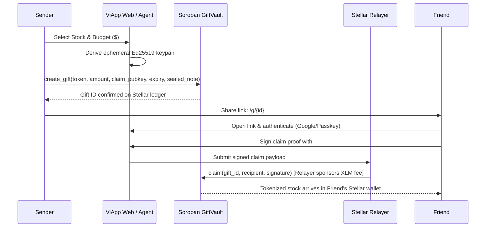

A gift has four core parts: the sender purchases tokenized shares with USDC/XLM, the Soroban `viapp-gift-vault` smart contract locks them on Stellar, an ephemeral URL carries the key in the `#` fragment, and the recipient opens and owns it.

---

## The Lifecycle of One Gift

1. **Pick an Equity & Budget:** The sender selects a tokenized stock (Apple, NVIDIA, Tesla, Microsoft, Alphabet, Meta, Amazon) and an amount from 1 to 100 USD. Prices are verified with oracle feeds.
2. **Instant Quote & Slippage Check:** ViApp computes the exact payment amount in native Stellar USDC or XLM. Slippage is bounded to 1%, and the oracle circuit-breaker enforces a maximum 2% price deviation band (`DEFAULT_PRICE_BAND_BPS = 200`).
3. **Locking in Escrow:** The sender's wallet signs the deposit transaction. The Soroban smart contract locks the tokenized stock in the vault, associates it with the ephemeral public key, and stores the encrypted message.
4. **Behind-the-Scenes Backing:** On-chain reserves are backed 1:1 by institutional assets via BNB Chain (`bStocks`), transitioning to direct native Stellar tokenization.
5. **Private Link Generation:** The sender's browser derives the shareable link: `https://<site>/g/<giftId>#<claimKey>`. The claim key exists only in the URL fragment (`#`), which browsers never transmit over HTTP.
6. **Recipient Onboarding:** The friend opens the link, signs in with Google, email, or a biometric passkey (Privy / Stellar WebAuth), and verifies their non-US eligibility.
7. **Gasless Claim:** The friend's browser signs a claim authorization using the link's key. ViApp's relayer wraps the transaction in a Stellar fee-bump envelope and submits it to the Stellar network, sponsoring all gas fees.
8. **Direct Ownership:** The tokenized equity settles in the friend's Stellar account in ~5 seconds.
9. **Instant Liquidity:** The recipient can hold the equity, liquidate to USDC on the Stellar Decentralized Exchange (SDEX), or cash out at MoneyGram locations worldwide.
10. **Reclaim on Expiry:** If the recipient never claims the gift before expiration (1 to 90 days), the sender can trigger `refund` to return the asset.

---

## Architectural Data Flow

---

## Why Stellar is the Foundation

- **Sub-Cent Fees:** Transaction fees on Stellar are `< $0.0001` per operation, allowing ViApp to sponsor recipient onboarding at scale.
- **5-Second Finality:** Stellar consensus reaches deterministic finality in 3-5 seconds without probabilistic rollups or reorgs.
- **Native DEX (SDEX):** Instant on-chain orderbook liquidity allows recipients to swap tokenized stocks directly for USDC or XLM.
- **MoneyGram Retail Off-Ramps:** Recipients can convert their stock gifts to physical cash at over 400,000 MoneyGram locations across 180+ countries.
